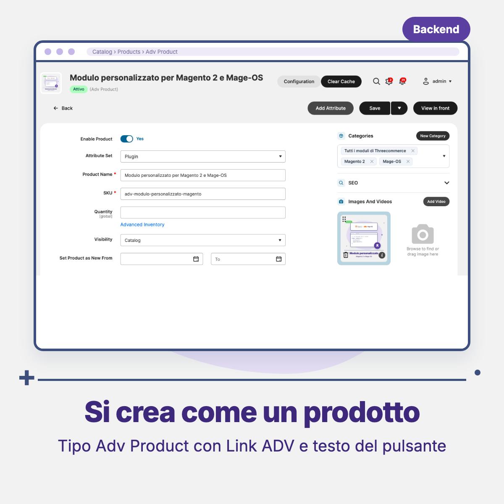
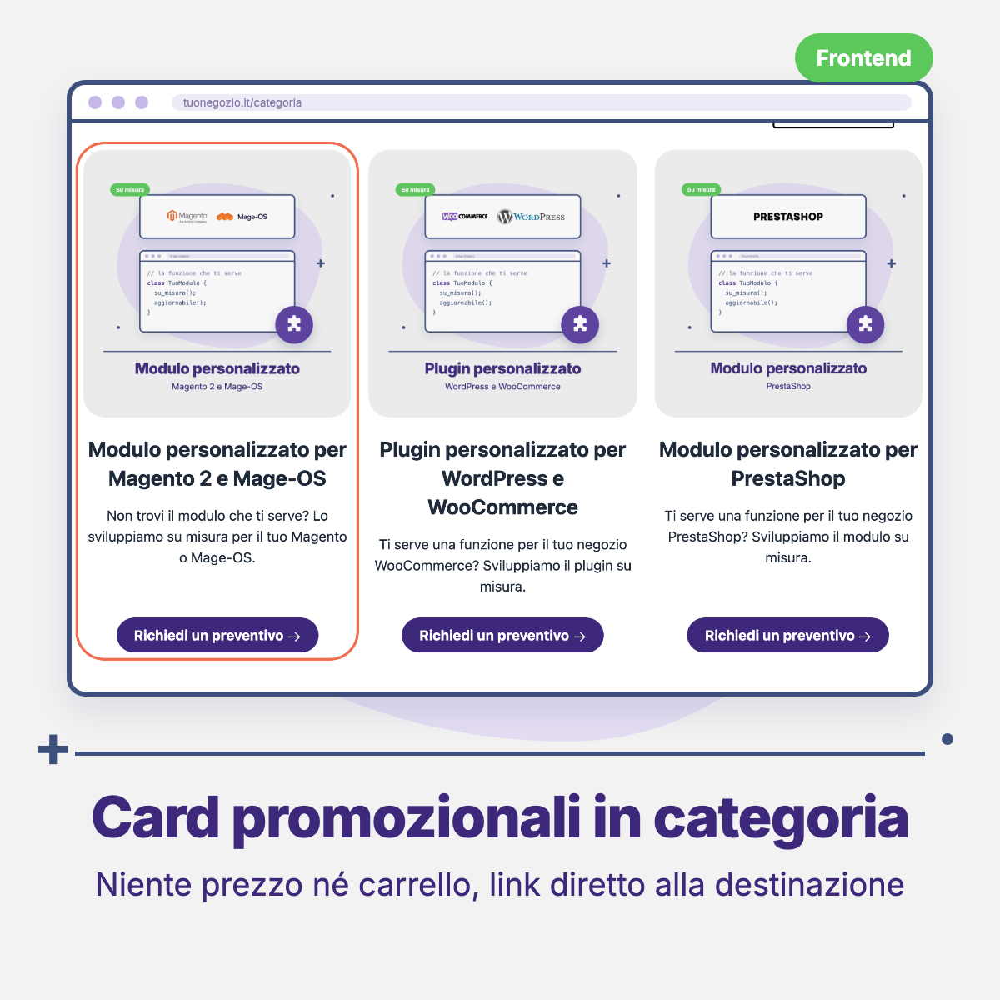

# Threecommerce_AdvProduct: promotional product type for Magento 2 / Mage-OS

An **Adv Product** type for Magento 2 and Mage-OS: promotional cards that sit in your category pages next to regular products and lead to an internal page or to another site (landing page, services, contact). They have no price and cannot be bought.

**Compatibility:** Magento Open Source / Adobe Commerce 2.4.4+ · Mage-OS · PHP 8.1 – 8.4 · Tested on Breeze; links, hidden price and redirect also work on Luma and Hyvä
**License:** commercial · coming soon

## Features

- New product type **Adv Product**, created from Catalog → Products like any other product.
- **Link ADV** (required): an internal path (`contact`, `/services/quote`) or a full URL (`https://…`, `mailto:`). Internal paths are completed with the store view URL.
- **Button text**: the call-to-action label (empty uses the default "Scopri di più" text).
- In category and search result lists the card links straight to the destination, with any theme.
- The product page redirects (302) to the Link ADV.
- No price box, never salable, add to cart is refused.
- Excluded from the XML sitemap.
- Price index set to 0, so the product still shows up in the category.
- A view model (`Threecommerce\AdvProduct\ViewModel\AdvProduct`) is passed to the category and search lists for custom themes: `isAdv()`, `getUrl()`, `isExternal()`, `getCtaLabel()`.
- Italian translation included.

## Requirements

- Magento Open Source / Adobe Commerce 2.4.4+ or Mage-OS
- PHP 8.1 – 8.4
- Package: `threecommerce/m2-base`

## Availability

This module is **not yet available for purchase**. See the [product page](https://www.threecommerce.it/prodotti-adv-magento-2?utm_source=github&utm_medium=readme&utm_campaign=magento2-advproduct) for the current status, or [get in touch](https://www.threecommerce.it/contatti?utm_source=github&utm_medium=readme&utm_campaign=magento2-advproduct) to be notified when it is released or to ask for details.

## Configuration

No settings page. Create the product from **Catalog → Products → Add Product → Adv Product**, fill in name and image and, in the **Adv** group, the Link ADV and the button text. Assign categories and position as for any product; visibility "Catalog" is recommended.

## Documentation and support

- Product page: [threecommerce.it/prodotti-adv-magento-2](https://www.threecommerce.it/prodotti-adv-magento-2?utm_source=github&utm_medium=readme&utm_campaign=magento2-advproduct)
- [Changelog](CHANGELOG.md) (in Italian)
- Questions and custom development: [threecommerce.it/contatti](https://www.threecommerce.it/contatti?utm_source=github&utm_medium=readme&utm_campaign=magento2-advproduct)

---

*This repository is the public showcase of the module. The source code is kept in a private repository.*
